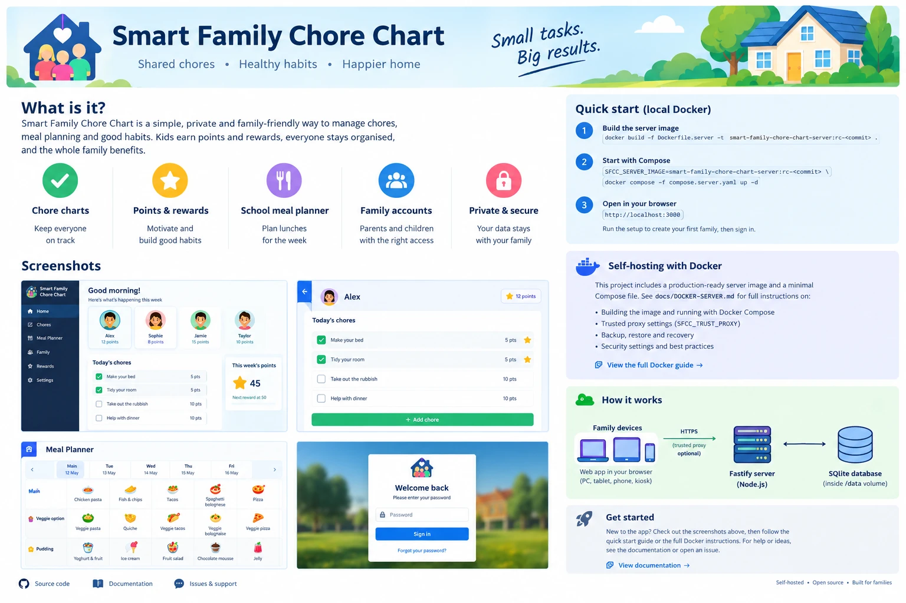

# Smart Family Chore Chart



> **About this image:** it's an AI-generated **conceptual preview**, not a screenshot of the real app. The real screens look different; for example, there's no sidebar, and parents sign in with a username *and* password. Some of its wording doesn't match this project:
> - The shared-server image (version 0.4.0) is meant for **private networks**, and has known [security limitations](#security-limitations-of-the-shared-server).
> - There's **no "Forgot your password?" link**; password recovery uses the server command line.
> - **Children don't have accounts**: parents sign in, and family devices are paired.
> - The project has **no open-source licence** (see [Licence](#licence)).
>
> The quick-start commands it shows match the real files.

A cheerful family chore chart for a large portrait touchscreen (built and tested for a 27-inch portrait screen) that also works on desktops, tablets and phones.
- Children tap their profile, tick off **Morning, Afternoon and Evening** chores, earn **points** and redeem **rewards**.
- The home screen shows each child's **school lunch** for the day, and parents plan school meals weeks ahead.

The app comes in two editions:

| | **Browser-only app** (v0.3.0, published) | **Shared family server** (v0.4.0) |
|---|---|---|
| Where data lives | In one browser on one device (localStorage) | In one SQLite database on your own server, shared by every device |
| Parent protection | A client-side PIN (a convenience lock, **not security**) | Parent accounts with passwords, checked by the server |
| Family devices | Each device has its own separate data | Kiosks are **paired** with one-time codes and share the same data |
| How to get it | Published image `ghcr.io/twmiddleton21-lgtm/smart-family-chore-chart` (`latest`) | Release image `ghcr.io/twmiddleton21-lgtm/smart-family-chore-chart-server:0.4.0` (a separate package, no `latest`), or build it from `Dockerfile.server` |
| Status | Released | **Version 0.4.0 for private LAN use; see the security limitations** |

> **Status of the shared family server.** It's on the `feature/shared-backend` branch and hasn't been merged into `main`.
> - **Versioned releases only:** the server is published as release [`server-v0.4.0`](https://github.com/twmiddleton21-lgtm/smart-family-chore-chart/releases/tag/server-v0.4.0), a versioned image with no `latest` tag (release candidate `server-v0.4.0-rc.1` remains available). Install it with [`docs/INSTALL-UBUNTU.md`](docs/INSTALL-UBUNTU.md).
> - **Tested locally only:** it has been tested on one computer (linux/amd64) with made-up data. No deployment behind a reverse proxy or Cloudflare Tunnel has been confirmed, and Raspberry Pi (ARM) compatibility is **unverified**.
> - **No live updates yet:** other devices show changes when they reload or regain focus.
> - **Not ready for real family data:** see [Security limitations](#security-limitations-of-the-shared-server) before using it with real data.

## Contents

- [Features](#features)
- [Visual preview](#visual-preview)
- [Shared family server (Docker)](#shared-family-server-docker)
  - [Requirements](#requirements)
  - [Install and start](#install-and-start)
  - [First-run setup](#first-run-setup)
  - [Parent accounts](#parent-accounts)
  - [Pairing family devices (kiosks)](#pairing-family-devices-kiosks)
  - [Shared data and sign-in behaviour](#shared-data-and-sign-in-behaviour)
  - [Bringing data from the browser-only app](#bringing-data-from-the-browser-only-app)
  - [Persistence, backup and restore](#persistence-backup-and-restore)
  - [Password reset](#password-reset)
  - [Upgrading and stopping](#upgrading-and-stopping)
  - [Networking, HTTPS and reverse proxies](#networking-https-and-reverse-proxies)
  - [Troubleshooting](#troubleshooting)
  - [Verifying an image](#verifying-an-image)
  - [Security limitations of the shared server](#security-limitations-of-the-shared-server)
- [Browser-only app (published image)](#browser-only-app-published-image)
- [Local development](#local-development)
- [Continuous integration](#continuous-integration)
- [Architecture](#architecture)
- [Data and privacy in the browser-only app](#data-and-privacy-in-the-browser-only-app)
- [Known limitations](#known-limitations)
- [Licence](#licence)

## Features

- **Child profiles:** first name or nickname, an emoji avatar and a colour. The home screen shows a large live clock, the date, a time-of-day greeting and a card per child with progress today and points balance.
- **Morning, afternoon and evening chores:** large touch toggles, grouped by time of day.
  - A done chore shows a checkmark, a "Done!" label, a colour change and a strikethrough, so state is never shown by colour alone.
  - Chores can repeat every day or on selected weekdays, and reset on their next scheduled day.
- **Completion tracking:** completions are recorded per child, chore and day. Progress updates instantly.
- **Points:** awarded once per chore per day and reversed if unticked. Balances are always calculated from the records, never stored separately.
- **Rewards:** redeemed with a confirmation and the right deduction, and refused when the balance is too low.
- **School meals and meal planning:**
  - A "Today's school lunch" card on the home screen.
  - Plan each child's **main** and **pudding** up to **6 weeks** ahead (Monday to Friday), with shared lists of food options and "copy previous week" and "clear week" helpers.
  - A reminder appears when a child's plan ends within 7 days.
- **Parent area:** manage children, chores, rewards, meals, food options and settings.
  - In the browser-only app it's behind a PIN.
  - On the shared server it needs a parent sign-in, and adds a **Family access** tab for parent accounts, your own password, paired devices and pairing codes.
- **Export and import:** export the family data as a JSON file. On the shared server, import it, with a preview, a confirmation and an automatic backup first.
- **Accessibility:** semantic HTML, labelled controls, keyboard-operable dialogs and tabs, visible focus rings, 48px+ touch targets and `prefers-reduced-motion` support.
- **Privacy:** no analytics, ads, trackers, CDNs or external requests. Only a first name or nickname, an avatar and a colour are stored per child.

## Visual preview

- **Mockups:** the image at the top of this page is a **conceptual mockup** generated for this README. Its "screenshots" are illustrations and differ from the real interface (see the note under the image).
- **Genuine screenshots:** none are in the repository yet. To see the real app, run the browser-only image (below) or a local copy of the shared server; both include an optional fictional demo family.

## Shared family server (Docker)

One container runs the Fastify server (Node.js 24), which serves both the app and the API. The family data, parent accounts and paired devices live in one SQLite database on a named Docker volume. Install on Ubuntu: [`docs/INSTALL-UBUNTU.md`](docs/INSTALL-UBUNTU.md). Full guide: [`docs/DOCKER-SERVER.md`](docs/DOCKER-SERVER.md). Moving an image to another Docker host: [`docs/DOCKER-TRANSFER.md`](docs/DOCKER-TRANSFER.md).

### Requirements

- **Docker** with the Compose plugin (Docker Engine on Linux, or Docker Desktop).
- **Git**, only if you build the image yourself. Otherwise use the published release image ([`docs/INSTALL-UBUNTU.md`](docs/INSTALL-UBUNTU.md)).
- About 300 MB of disk space for the image. Tested on **linux/amd64** only.

### Install and start

**From the release (recommended):** follow [`docs/INSTALL-UBUNTU.md`](docs/INSTALL-UBUNTU.md). It covers copy-and-paste Ubuntu commands, `.env` settings, LAN access from another PC, backups, updates and uninstalling. The image is `ghcr.io/twmiddleton21-lgtm/smart-family-chore-chart-server:0.4.0` (linux/amd64); the [release page](https://github.com/twmiddleton21-lgtm/smart-family-chore-chart/releases/tag/server-v0.4.0) lists its digest and an image archive for hosts that can't pull.

**Or build it yourself from source:**

Bash (Linux, macOS, Git Bash on Windows):

```bash
git clone --branch feature/shared-backend https://github.com/twmiddleton21-lgtm/smart-family-chore-chart.git
cd smart-family-chore-chart

# Build the image with a unique tag (never "latest")
export SFCC_SERVER_IMAGE=smart-family-chore-chart-server:rc-$(git rev-parse --short HEAD)
docker build -f Dockerfile.server -t "$SFCC_SERVER_IMAGE" .

# Start it (published on this computer only, port 3000)
SFCC_TIMEZONE=Europe/London docker compose -f compose.server.yaml up -d
docker compose -f compose.server.yaml ps          # wait for "healthy"
```

PowerShell (Windows):

```powershell
git clone --branch feature/shared-backend https://github.com/twmiddleton21-lgtm/smart-family-chore-chart.git
cd smart-family-chore-chart
$env:SFCC_SERVER_IMAGE = "smart-family-chore-chart-server:rc-$(git rev-parse --short HEAD)"
docker build -f Dockerfile.server -t $env:SFCC_SERVER_IMAGE .
$env:SFCC_TIMEZONE = "Europe/London"
docker compose -f compose.server.yaml up -d
docker compose -f compose.server.yaml ps
```

Then open **http://localhost:3000** on the same computer.

Settings read by `compose.server.yaml`, from a `.env` file next to it (copy [`.env.example`](.env.example)) or from the environment:

| Variable | Default | Meaning |
|---|---|---|
| `SFCC_SERVER_IMAGE` | **required** | The local image tag to run. Compose refuses to start without it, and never pulls or builds (`pull_policy: never`). |
| `SFCC_BIND_ADDRESS` | `127.0.0.1` | Address on this machine to publish the port on: `127.0.0.1` (this machine only), or one specific private LAN address. Never `0.0.0.0`. |
| `SFCC_HOST_PORT` | `3000` | Port on this machine. |
| `SFCC_TIMEZONE` | `UTC` | Household time zone (IANA name such as `Europe/London`), used for "today". |
| `SFCC_COOKIE_SECURE` | `auto` | `auto`, `always` or `never` (see [HTTPS](#networking-https-and-reverse-proxies)). |
| `SFCC_TRUST_PROXY` | empty | Trusted reverse-proxy addresses (see [reverse proxies](#networking-https-and-reverse-proxies)). |
| `SFCC_ALLOWED_HOSTS` | empty | Other host names or addresses the server answers to, besides `localhost`, `127.0.0.1` and `[::1]` (see [networking](#networking-https-and-reverse-proxies)). |

The image always runs in production mode (`NODE_ENV=production`). It runs as an unprivileged user with a read-only root filesystem, all Linux capabilities dropped, and a health check on `/readyz`. The development-only mode without sign-in can't be enabled in it.

### First-run setup

1. Read the one-time setup code from the logs:
   ```bash
   docker compose -f compose.server.yaml logs app
   ```
   Look for `FIRST-RUN SETUP … setup code: XXXX-XXXX-XXXX`. A new code is printed at each start until setup is done, and it works only once.
2. Open the app, enter the code, and create the first parent account. The username is 3–32 letters, numbers, dots, dashes or underscores. The password needs at least 10 characters, must not be a very common password, and must not contain the username.
3. The household starts empty. Add children, chores and rewards in the **Parent area**, or load the fictional demo family (Parent area → Settings) to try things out.

### Parent accounts

- All parents are equal. Any parent can add another parent, change their own password, or remove a parent after re-entering their own password; the last parent can't be removed. All of this is in **Parent area → Family access**.
- **Sign-in:** parents sign in with a username and password. Sessions end after **30 minutes without activity** or **12 hours** at most.
- **"Keep me signed in on this device"** lasts up to 30 days. Only use it on your own phone or computer, never on a shared kiosk.
- **Rate limits:** after 5 failed sign-ins within 15 minutes (per account and per address), further attempts are refused for a while.

### Pairing family devices (kiosks)

1. On a parent's device: **Parent area → Family access → Create pairing code**, naming the device (for example "Kitchen screen"). The code works **once**, within **10 minutes**.
2. On the kiosk: open the app and enter the code under **Connect this device → Pair this device**.

A paired device can **view the family, tick chores, redeem rewards and dismiss the meal reminder**. Everything else needs a parent to sign in on it. Parents can unpair a device at any time in Family access, and it loses access immediately.

### Shared data and sign-in behaviour

- **One source of truth:** every device reads and writes the same server.
  - After each change, the app re-reads the server's data. Other devices show it when they reload or the window regains focus; there are no live updates yet.
  - If two devices edit the same item, the later save is refused and the latest version is shown.
- **Signing out:** "Sign out", and "Done – lock & exit" on a kiosk, lock the screen at once. They only report success once the server confirms the session ended. If it can't confirm, the screen stays locked and a warning says the session may still be active.
- **Idle lock:** after **30 minutes without input** in the parent area, it locks and the parent is signed out.
- **Kiosk reload:** reloading a kiosk, or restarting its browser, signs out any parent session it finds, so the parent area always asks for the password again.

### Bringing data from the browser-only app

1. In the old browser-only app: Parent area → Settings → **Export family data**. In v0.3.0, which has no Export button, see [`docs/SERVER-DEVELOPMENT.md`](docs/SERVER-DEVELOPMENT.md#export-and-import).
2. On the shared server: Parent area → Settings → **Import from a file**.
3. Check the preview and confirm.

The server validates everything, takes a backup first, and never imports the old PIN.

### Persistence, backup and restore

- **Where data lives:** the database and its backups live in the named volume mounted at `/data`. Its name is `<project>_chorechart-data`, where the project defaults to the folder name. It survives container restarts, recreation and upgrades.
- **`down -v` deletes the volume and all family data.**

```bash
# Online backup (safe while running), written to /data/backups
docker compose -f compose.server.yaml exec app node dist-server/cli.js backup manual
docker compose -f compose.server.yaml exec app node dist-server/cli.js status   # lists backups
docker compose -f compose.server.yaml cp app:/data/backups/<file> ./            # copy one out

# Restore: offline (stop the app first)
docker compose -f compose.server.yaml stop app
docker compose -f compose.server.yaml run --rm app node dist-server/cli.js restore /data/backups/<file> --yes
docker compose -f compose.server.yaml start app
```

**Git Bash on Windows** rewrites arguments that look like Unix paths (such as `/data/backups/…`) before Docker sees them, so the restore fails with "File not found". Run it as `MSYS_NO_PATHCONV=1 docker compose … restore /data/backups/<file> --yes`, or use PowerShell, where it works as shown.

- **A restore signs everyone out:**
  - Sessions, paired devices and pairing codes from the backup are removed, so a backup can't bring back old sign-ins.
  - Parents sign in again and kiosks are paired again.
  - Passwords are as they were when the backup was taken. If one was changed since, reset it.
- **The previous database is kept:** it's moved to `/data/backups/replaced-<time>.db`.
- **Keep backups private:** they contain the family's data and password hashes.
- **No scheduled backups:** run the backup command yourself or from a scheduled task.

### Password reset

There's no e-mail reset. Use the server command line:

```bash
docker compose -f compose.server.yaml exec app node dist-server/cli.js list-parents
docker compose -f compose.server.yaml exec app node dist-server/cli.js reset-password <username>
```

This prints a temporary password and signs that parent out everywhere. Sign in with it and change it straight away in Family access.

### Upgrading and stopping

- **To upgrade:**
  1. Take a backup.
  2. `git pull`, and build a new image with a new tag.
  3. Set `SFCC_SERVER_IMAGE` to it and run `docker compose -f compose.server.yaml up -d`.

  A newer version migrates the database at start-up, after an automatic backup. An older image refuses to open a newer database.
- **To stop:** `docker compose -f compose.server.yaml stop` (or `down`, which keeps the volume). The server shuts down cleanly on `SIGTERM`.

### Networking, HTTPS and reverse proxies

- **Default: this computer only.** The port is published on `127.0.0.1`.
  - To use it from other devices on your home network, set `SFCC_BIND_ADDRESS` and `SFCC_ALLOWED_HOSTS` to this machine's private LAN address (for example `192.168.1.20`; find it with `hostname -I`), and open `http://<LAN-IP>:<port>` on the other device. Only do this on a network you trust: it is then plain HTTP. Don't use `0.0.0.0`.
- **Host names:** the server only answers to `localhost`, `127.0.0.1`, `[::1]` and the names in `SFCC_ALLOWED_HOSTS`. Anything else gets 421. This blocks DNS-rebinding attacks, where another website points its own name at your server.
  - To reach it from elsewhere, prefer an SSH tunnel or a VPN over opening ports.
- **Plain HTTP:** for direct local testing, keep `SFCC_COOKIE_SECURE=auto`.
- **HTTPS behind a reverse proxy** (Caddy, nginx, a tunnel): either set `SFCC_COOKIE_SECURE=always`, or list the proxy in `SFCC_TRUST_PROXY` and keep `auto`. A trusted proxy also gives the rate limits each client's real address; without one, everyone behind the proxy shares one limit.
- **`SFCC_TRUST_PROXY` requirements:**
  - List only IP addresses or CIDR ranges that belong to the proxy hops the container sees. Never list the Docker host gateway.
  - The proxy must append the real client to `X-Forwarded-For`, send `X-Forwarded-Proto: https`, and **pass the original `Host` header through**. Otherwise every change is refused as cross-site.
  - Add the public host name to `SFCC_ALLOWED_HOSTS`.
  - Full details: [`docs/DOCKER-SERVER.md`](docs/DOCKER-SERVER.md#trusted-reverse-proxy-exact-requirements).
- **Not yet confirmed:** no reverse-proxy or Cloudflare Tunnel deployment has been tested.

### Troubleshooting

| Problem | What to do |
|---|---|
| `required variable SFCC_SERVER_IMAGE is missing a value` | Set `SFCC_SERVER_IMAGE` to the tag you built (see above). |
| `No such image: smart-family-chore-chart-server:…` | Compose never pulls this image. Build it (`docker build -f Dockerfile.server …`), or `docker load` it from an archive ([transfer guide](docs/DOCKER-TRANSFER.md)). |
| Port 3000 already in use | Set `SFCC_HOST_PORT` to another free port. |
| Container not `healthy` | `docker compose -f compose.server.yaml logs app`. The server says why it refused to start (for example an invalid `SFCC_TIMEZONE`). |
| No setup code in the logs | It's only printed while no parent exists. Restart the container to print a new one. If parents exist, sign in, or use `reset-password`. |
| "This server doesn't answer to this address" (421) | Add the host name or address you're using to `SFCC_ALLOWED_HOSTS`. `localhost`, `127.0.0.1` and `[::1]` always work. |
| "Requests from other websites are not allowed" (403) | The browser's `Origin` doesn't match the `Host` the server sees. Behind a proxy, pass the original `Host` header through. |
| Sign-in doesn't stick when you use plain HTTP at an address other than `localhost` | The cookies are marked `Secure` (`SFCC_COOKIE_SECURE=always`, or a trusted proxy said HTTPS), and browsers only accept those over HTTPS or on `localhost`. Use HTTPS, or `auto` for plain-HTTP testing. |
| "Too many sign-in attempts" (429) | Wait up to 15 minutes. Restarting the container also clears the counters. |
| A kiosk shows "Connect this device" again | It was unpaired, its pairing expired, or a backup was restored. Pair it again with a new code. |
| The parent area asks for the password after a kiosk reload | Intended: kiosks never keep a parent signed in across a reload. |

### Verifying an image

For developers, with Node.js, `npm ci` and Google Chrome installed:

```bash
npm run verify:docker -- --image smart-family-chore-chart-server:rc-<commit>
```

This starts the image in a disposable Compose project with made-up data. It checks start-up, that development mode can't be enabled, setup, sign-in, pairing, shared data, restart persistence, kiosk reload, the idle lock, sign-out, backup and restore, and `reset-password`. At the end it removes only what it created.

### Security limitations of the shared server

Automated tests passing doesn't make these go away:

- **Not production-ready for every environment.** It has been tested locally only, with made-up data, not behind a real reverse proxy or tunnel, and not on ARM.
- **Rate limits** are kept in memory: a restart resets them. Anyone who can reach the sign-in page can keep a username locked out for 15 minutes at a time.
- **Over plain HTTP,** sessions and passwords aren't encrypted in transit. Use HTTPS beyond your own computer.
- **The setup code** appears in the container logs until setup is done.
- **An unconfirmed sign-out** leaves the session active until a retry succeeds or it expires.
- **Two tabs signing in at the same moment** can leave one session orphaned until it expires. Nobody gains access.
- **A restore** requires every kiosk to be paired again, and brings back the backup's passwords.
- **Backups** contain password hashes. There are no scheduled backups.
- **Not yet implemented:** asking for the password again before adding a parent or creating a pairing code.
- **Node.js's built-in SQLite module is still marked experimental.**
- **Details:** [`docs/SERVER-DEVELOPMENT.md`](docs/SERVER-DEVELOPMENT.md) and [`docs/DOCKER-SERVER.md`](docs/DOCKER-SERVER.md).

## Browser-only app (published image)

The released v0.3.0 app stores all family data in the browser's localStorage on one device. There's no backend, no shared data, and no server-side authentication. The image serves the static app only.

```
ghcr.io/twmiddleton21-lgtm/smart-family-chore-chart
```

| Tag | Meaning |
|---|---|
| `latest` | The most recent successful build of `main`. Moves with every push to `main`. |
| `sha-<full 40-character commit SHA>` | Immutable. Identifies exactly one commit; use it to pin or roll back. |

The image is a static web app served by **nginx (unprivileged, non-root)** on **port 8080**. It has a health check at `GET /healthz`, strict security headers, gzip, and long-term caching for hashed assets. It holds **no family data**.

### Pull and run

```bash
docker pull ghcr.io/twmiddleton21-lgtm/smart-family-chore-chart:latest

# Run on this machine only (loopback), then open http://127.0.0.1:8080
docker run -d --name smart-family-chore-chart \
  -p 127.0.0.1:8080:8080 \
  --read-only --tmpfs /tmp --cap-drop ALL --security-opt no-new-privileges:true \
  --restart unless-stopped \
  ghcr.io/twmiddleton21-lgtm/smart-family-chore-chart:latest
```

The app starts with a **fictional demo family**. The demo parent PIN is **1234**; change it in Parent area → Settings.

### Docker Compose

`compose.yaml` defines a hardened `web` service: read-only filesystem, all capabilities dropped, `no-new-privileges`, and **no published host port and no volumes** (a static app has nothing to persist).

```bash
docker compose pull
docker compose up -d
```

To reach it, attach the service to your reverse proxy's network, or publish a port in a local `compose.override.yaml` (not committed):

```yaml
services:
  web:
    ports:
      - "127.0.0.1:8080:8080"
```

Set `SFCC_IMAGE` to pin a specific build, for example `SFCC_IMAGE=ghcr.io/twmiddleton21-lgtm/smart-family-chore-chart:sha-<commit> docker compose up -d`.

### Updating and building locally

```bash
docker pull ghcr.io/twmiddleton21-lgtm/smart-family-chore-chart:latest
docker compose up -d          # recreates the container only if the image changed
docker image prune            # optional: remove old, unused images

docker build -t smart-family-chore-chart:local .   # build the browser-only image yourself
```

To roll back, run a previous `sha-…` tag. Family data lives in browsers, so updating the container doesn't touch it. The image is a multi-stage build: `node:24.21.0-alpine3.24` builds the app, then `nginxinc/nginx-unprivileged:1.30.5-alpine3.24` serves `dist/`. Both base images are pinned by tag **and** digest.

## Local development

Requires **Node.js 22.12+ or 24** (see `.nvmrc`) and **npm**.

```bash
npm ci                 # install exact versions from package-lock.json
npm run dev            # browser-only app on http://localhost:4174
```

| Command | What it does |
|---|---|
| `npm run dev` | Vite dev server for the browser-only app on port **4174** (`strictPort`). |
| `npm run build` | Type check, then the browser-only production build into `dist/`. |
| `npm run preview` | Serve the built `dist/` on port 4174. |
| `npm test` | Vitest unit and server tests. |
| `npm run test:e2e` | Playwright browser tests (uses the installed Google Chrome; starts its own throwaway servers). |
| `npm run typecheck` | TypeScript check (frontend and server). |
| `npm run dev:server:auth` + `npm run dev:api` | Shared server with sign-in (port 3000) and the server build of the app (port 4175). A setup code is printed on first start. |
| `npm run dev:server` | Development-only server **without sign-in**, limited to this computer (refused in production). |
| `npm run build:app` / `npm run build:server` | Production builds of the server version of the app (`dist-app/`) and of the server (`dist-server/`). |
| `npm run server:cli -- <command>` | Server maintenance: `status`, `backup`, `prune`, `verify`, `restore`, `list-parents`, `reset-password`. |
| `npm run verify:docker -- --image <tag>` | End-to-end check of a built server image (see above). |

More: [`docs/SERVER-DEVELOPMENT.md`](docs/SERVER-DEVELOPMENT.md).

## Continuous integration

`.github/workflows/ci.yml` (unchanged; it covers the **browser-only** image):

- **Pull requests to `main`:** `npm ci`, type check, unit tests, production build, and a Docker image build (not published).
- **Pushes to `main`:** the same checks, then publish the browser-only image to GHCR with the `latest` and `sha-<commit>` tags.
- **Least privilege:** `contents: read` everywhere, and `packages: write` only on the publish job, with the built-in `GITHUB_TOKEN`. Third-party actions are pinned to full commit SHAs.
- **No deployment step,** and no server image is built or published by CI.

## Architecture

```
src/                       The app (React 19, TypeScript 6, Vite 8, plain CSS)
  lib/                     Pure business rules (chores, points, rewards, meals, validation), unit tested
  state/                   Stores: browser-local (localStorage) or server (API), sign-in state, idle lock
  screens/, components/    UI, including auth/ (setup, sign-in, pairing) and parent/ (parent area)
server/                    Shared family server (Fastify 5, node:sqlite)
  app.ts                   HTTP API, access control, CSRF checks, security headers, static app
  auth/                    Parent accounts, sessions, devices, pairing codes, rate limits
  family/                  Versioned family document, commands (using src/lib rules), import/export
  db/                      SQLite access, migrations, verified backups and restore
  cli.ts                   Maintenance commands (backup, restore, reset-password…)
e2e/                       Playwright browser tests
docs/                      Server, Docker and transfer guides, and the shared-data plan
Dockerfile, compose.yaml   Browser-only image (published)
Dockerfile.server, compose.server.yaml   Shared family server (built locally)
```

The data source is chosen at build time: the default build is browser-only, and `--mode api` builds the server version.

## Data and privacy in the browser-only app

- **Storage:** data is stored in localStorage under `smart-family-chore-chart:data`, as one JSON document (format `version: 3`). Older formats are upgraded automatically.
- **Validation:** everything is validated on load. Unreadable data is copied to `smart-family-chore-chart:unreadable-backup` before sample data is loaded.
- **Scope:** data belongs to one **browser profile and site address**.
- **Reset:** Parent area → Settings → **Reset to sample data**.
- **The PIN isn't real security.** It's stored in plain text in the browser and checked there. It only keeps children out of the settings.
- **No outside contact:** no backend, accounts, analytics or external requests. Family data never leaves the browser.

## Known limitations

- **Browser-only app:** one device per data set. Clearing site data erases everything, and the PIN is client-side only.
- **Shared family server:**
  - **Not done yet:** live updates between devices, scheduled backups, and confirmed reverse-proxy, Cloudflare Tunnel or Raspberry Pi deployments.
  - Also see its [security limitations](#security-limitations-of-the-shared-server).
- **Both editions:**
  - There's no parent approval step for reward redemptions, and rewards are shared by all children.
  - School meals have no rotating-menu import or option renaming. Meals older than 4 weeks are pruned when a week is saved.
  - Native dropdowns can't wrap long names on narrow screens.
- **Images:** only `linux/amd64` images have been built.

## Licence

There's no licence file in this repository, and no licence has been chosen yet.
